# Vibe coding platform · target architecture

**One shared hub, one sandbox per session, one governed path to production.**

Business people ("AI builders") describe an app in plain language. Agents build it in an isolated workspace while the builder watches a live preview. Publish opens a pull request, and the GitHub pipeline deploys the app to its domain's spoke, following the app's risk tier.

- **Scope:** one company, on Google Cloud, using generally available services only.
- **Status:** target design for v1. Open points are listed at the end.

**Colours used in the diagrams**

| Colour | Meaning |
|---|---|
| Yellow | People |
| Purple | Outside GCP: Okta, GitHub, Trust Layer |
| Peach | Created for each session |
| Grey | GCP service |

## Contents

1. [Overview](#1-overview)
2. [Full architecture](#2-full-architecture)
3. [Builder journey](#3-builder-journey)
4. [How a message is handled](#4-how-a-message-is-handled)
5. [Workspace lifecycle](#5-workspace-lifecycle)
6. [Branches](#6-branches)
7. [Project template](#7-project-template)
8. [Publish and risk tiers](#8-publish-and-risk-tiers)
9. [Identity and model calls](#9-identity-and-model-calls)
10. [Day two](#10-day-two)
11. [Components](#11-components)
12. [Guardrails](#12-guardrails)
13. [Cost](#13-cost)
14. [Decisions and open points](#14-decisions-and-open-points)

---

## 1. Overview

```mermaid
%%{init: {"theme": "base", "themeVariables": {"primaryColor": "#EEF0F2", "primaryBorderColor": "#8A949C", "primaryTextColor": "#211C19", "lineColor": "#5F6B73", "clusterBkg": "#FAF8F4", "clusterBorder": "#CFC5B4", "edgeLabelBackground": "#FFFFFF"}}}%%
flowchart LR
    builders["AI builders"]
    subgraph HUB["Hub · shared by everyone"]
        studio["Builder Studio<br/>Web UI · Platform API · agent service"]
    end
    subgraph PERSESSION["Created for each session"]
        ws["Session workspace<br/>one Cloud Run service per session"]
    end
    gh["GitHub<br/>app repo · pull requests · Actions"]
    subgraph SPOKES["Spoke · one per domain"]
        spokes["Lab · Staging · Production"]
    end
    tl["Trust Layer"]
    vx["Vertex AI · Claude"]
    data[("Domain data<br/>read-only connectors")]
    cross["Security · governance · observability · FinOps<br/>across hub and spokes"]

    builders -->|"chat + live preview"| studio
    studio -->|"tool calls"| ws
    ws -->|"git push"| gh
    gh -->|"Terraform, keyless"| spokes
    studio -->|"every model call"| tl
    spokes -->|"app model calls"| tl
    tl --> vx
    spokes --> data

    classDef default fill:#EEF0F2,stroke:#8A949C,color:#211C19
    classDef people fill:#FBE9A6,stroke:#B8962E,color:#211C19
    classDef ext fill:#E7DDF6,stroke:#7B5FB0,color:#211C19
    classDef session fill:#FBD9C3,stroke:#C9773F,color:#211C19
    class builders people
    class gh,tl ext
    class ws session
```

- **Hub:** everything shared. The UI, the APIs, the agents and their state live in one hub project owned by the Platform Owner.
- **Workspace:** the only place agent-written code runs. It has synthetic data only, no route to the spokes, and its only way out is a pull request.
- **Spokes:** one per domain, owned by the Domain Owner. Each has a non-production project (Lab, Staging) and a production project.

## 2. Full architecture

Every GCP component, with the main flows. Section 11 describes each one.

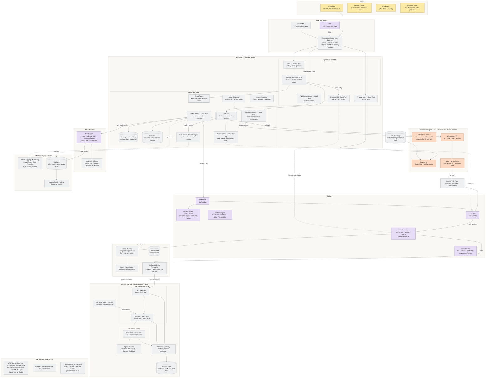

## 3. Builder journey

From sign-in to Publish. The workspace starts while the builder answers the intake questions, so they never wait for it.

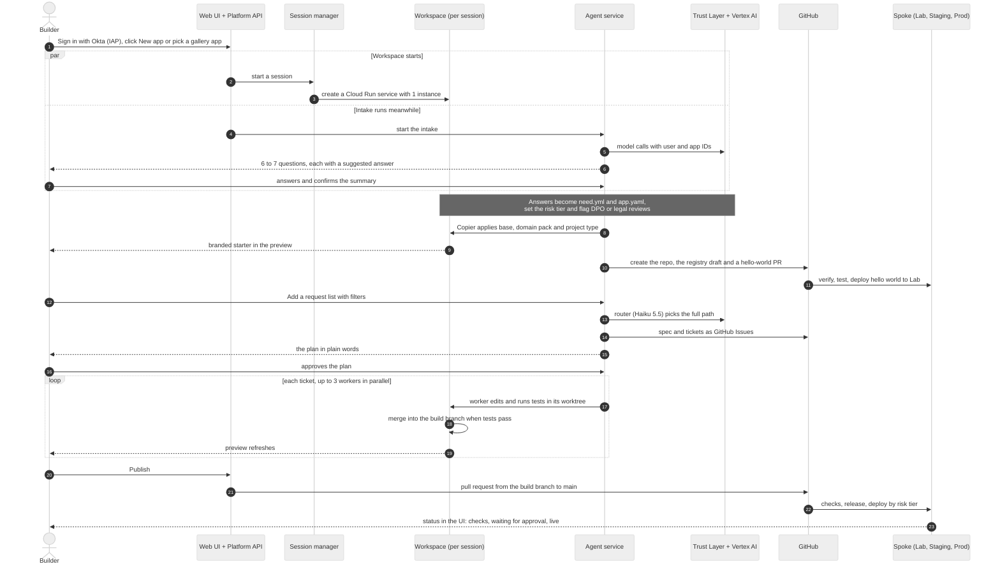

## 4. How a message is handled

Every message goes through a router. Small, safe changes take the fast path. Anything bigger goes through a spec and tickets built by parallel worker agents.

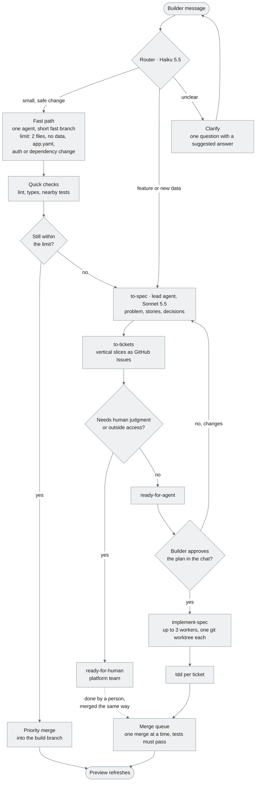

The skills come from a fork of [mattpocock/skills](https://github.com/mattpocock/skills) (MIT), pinned to a version and shipped as protected files in the base template. The platform triggers them; an agent never starts one on its own.

## 5. Workspace lifecycle

The branch is the source of truth. A workspace can disappear at any time and be rebuilt from the branch.

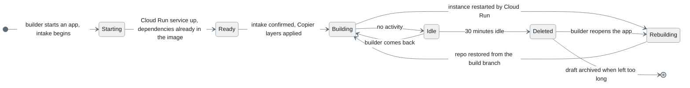

- Each accepted change is a commit pushed to the build branch, so a restart loses at most the change in progress.
- The session manager enforces limits per session: a token budget, at most 3 worker agents, and the idle timeout.

## 6. Branches

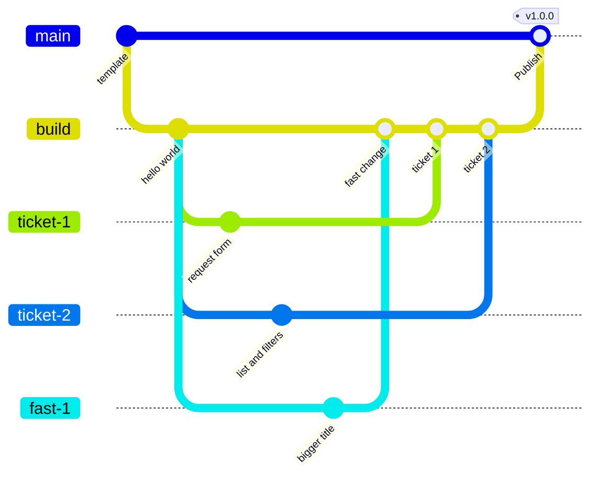

- **main:** what is released. It changes only through Publish.
- **build/&lt;app&gt;:** the shared working branch of a session. The preview runs from it.
- **ticket/&lt;n&gt;:** one per worker agent, in its own git worktree. It merges into the build branch only when its tests pass.
- **fast/&lt;id&gt;:** one per fast-path change. It merges first.

## 7. Project template

The intake answers fill the template. The agent starts in a ready repo with the rules already in place.

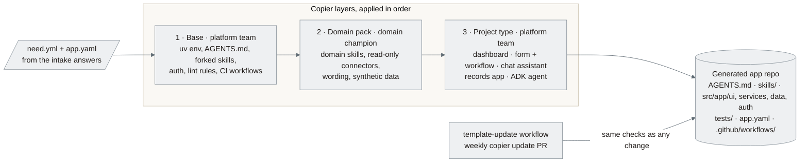

- **Protected files:** AGENTS.md, `skills/`, `.github/`, `src/app/auth/`, the lint rules. CI fails if an agent changes them.
- **Thin workflows:** each app's workflow only calls shared workflows from a platform repo, pinned to a version.

## 8. Publish and risk tiers

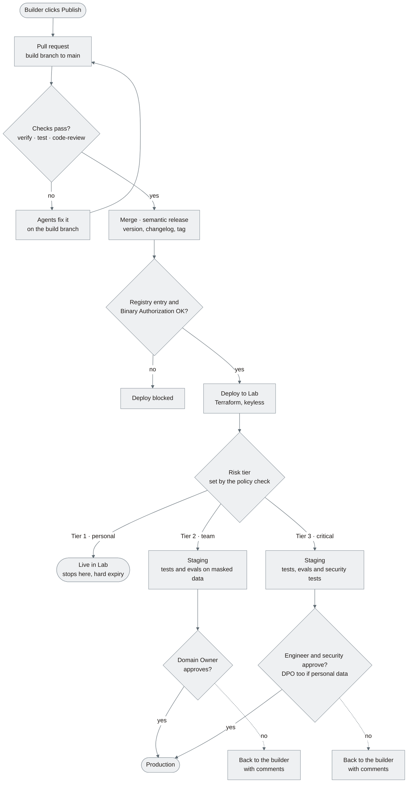

| Tier | Data and users | Publish goes to | Approval |
|---|---|---|---|
| 1 · Personal | Author only, no sensitive data, read-only | Lab, and it stops there | None, hard expiry |
| 2 · Team | Internal data, read-only | Lab, Staging, Production | Domain Owner |
| 3 · Critical | Client data or write access | Lab, Staging with security tests, Production | Engineer and security, plus the DPO for personal data |

- The policy check sets the tier from `app.yaml`. The builder can't pick a lower one.
- Sharing an app beyond its author makes it Tier 2.
- DPO and legal needs are flagged at intake, so reviews run while the app is built.

## 9. Identity and model calls

The same Okta user ID follows every step, so each model call is traced and costed per user and per app.

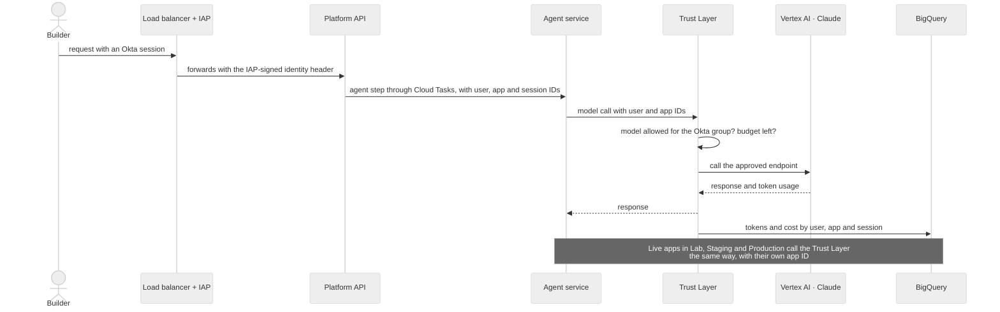

## 10. Day two

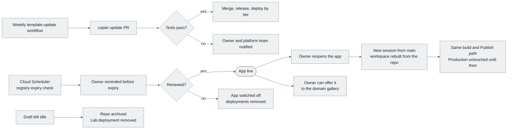

## 11. Components

| Zone | Component | Service | What it does |
|---|---|---|---|
| Edge | Load balancer | External Application Load Balancer, Cloud Armor, IAP | Single entry point, WAF, Okta sign-in through Workforce Identity Federation |
| Edge | DNS and TLS | Cloud DNS, Certificate Manager | Domain names and managed certificates |
| Hub | Web UI | Cloud Run | Gallery, chat and preview panels |
| Hub | Platform API | Cloud Run | Sessions, intake, Publish, status to the UI |
| Hub | Preview proxy | Cloud Run | Serves a session's preview to its author only |
| Hub | Registry API | Cloud Run + Firestore | Owner, tier and expiry of every app. No entry, no deploy |
| Hub | Webhook receiver | Cloud Run | Receives GitHub events and publishes them to Pub/Sub |
| Hub | Agent service | Cloud Run | Intake, router, lead and worker agents. Harness to decide |
| Hub | Session manager | Cloud Run + Cloud Run Admin API | Creates and deletes workspaces, applies limits, mints short-lived GitHub tokens |
| Hub | Agent steps | Cloud Tasks | One short request per agent step, with retries and rate limits |
| Hub | Live state | Memorystore for Valkey | Session to workspace map, plan, merge lock, UI events |
| Hub | Durable state | Firestore | Sessions, conversations, plans, registry records |
| Hub | Events | Pub/Sub | GitHub, deploy and review events |
| Hub | Schedules | Cloud Scheduler | Idle-workspace reaper, registry expiry checks |
| Hub | Review runner | Cloud Run job | Runs code-review on each pull request and posts a GitHub check |
| Hub | Eval runner | Cloud Run job | Evals and benchmark prompts on Staging, results to BigQuery |
| Hub | Secrets | Secret Manager | GitHub App key, Okta client, Trust Layer credentials |
| Workspace | Session workspace | One Cloud Run service per session | 1 instance, 4 vCPU / 8 GiB, created at intake, deleted after 30 minutes idle |
| Workspace | Egress | Direct VPC egress, Secure Web Proxy | Outbound only to the Trust Layer, the package mirror and GitHub |
| Workspace | Synthetic data | Cloud Storage | One set per domain pack, the only data a workspace sees |
| Delivery | Repos, tickets, CI | GitHub, GitHub App, GitHub Actions | One repo per app, tickets as Issues, verify · test · release · deploy · template-update |
| Delivery | Images and mirror | Artifact Registry | Workspace and app images, PyPI and npm mirror |
| Delivery | Image policy | Binary Authorization | Only pipeline-built images deploy |
| Delivery | Keyless deploy | Workload Identity Federation | GitHub OIDC to one service account per environment |
| Delivery | Terraform state | Cloud Storage | One bucket per domain |
| Spoke | Lab, Staging, Production | Cloud Run + IAP, in a non-production and a production project | Where apps run, by tier |
| Spoke | App resources | Approved Terraform modules | Firestore, Cloud SQL, Cloud Storage, Pub/Sub, Cloud Scheduler |
| Spoke | Masked data | Sensitive Data Protection | Masked copies of domain data for Staging |
| Spoke | Connectors | Connector gateway (Apigee or the corporate gateway) | Read-only access to domain data |
| Models | Trust Layer | Corporate AI gateway | Every model call, with user and app IDs and budgets |
| Models | Models | Vertex AI · Claude | Sonnet 5.5, Haiku 5.5, Opus 5.5 on request |
| Security | Perimeter and policy | VPC Service Controls, Organization Policies, IAM, Security Command Center, Cloud Audit Logs, Cloud KMS | Isolation, guardrails, audit, CMEK where required |
| Security | Data classification | Dataplex Universal Catalog | Classifies connectors and datasets for tiering |
| Observability | Logs, metrics, traces | Cloud Logging, Cloud Monitoring, Cloud Trace, Error Reporting | One view across hub and spokes |
| FinOps | Cost and usage | BigQuery, Looker Studio, Cloud Billing budgets, labels | Cost per domain, app, user and session |

## 12. Guardrails

- Builders never see code or infrastructure. The workspace never deploys: its only way out is a pull request.
- **Workspace network:** outbound only to the Trust Layer, the package mirror and GitHub, through Secure Web Proxy. No route to the spokes, synthetic data only.
- Agents follow AGENTS.md and the domain skills. Changing a protected file fails CI.
- Every model call goes through the Trust Layer with the user and app IDs.
- No registry entry, no deployment. Every app has an owner, a tier and an expiry date.
- **Production:** no human write access. Deploys run only through the pipeline, keyless, with one service account per environment.
- **Per session:** a token budget, at most 3 worker agents, a 30-minute idle timeout, cost shown to the builder.
- **Gallery:** owners opt in. A copy takes the code, never the data access, and is tiered and approved again.
- VPC Service Controls around hub and spokes, Organization Policies, CMEK where the company requires it.

## 13. Cost

List prices, before negotiated discounts. Model tokens are most of the bill.

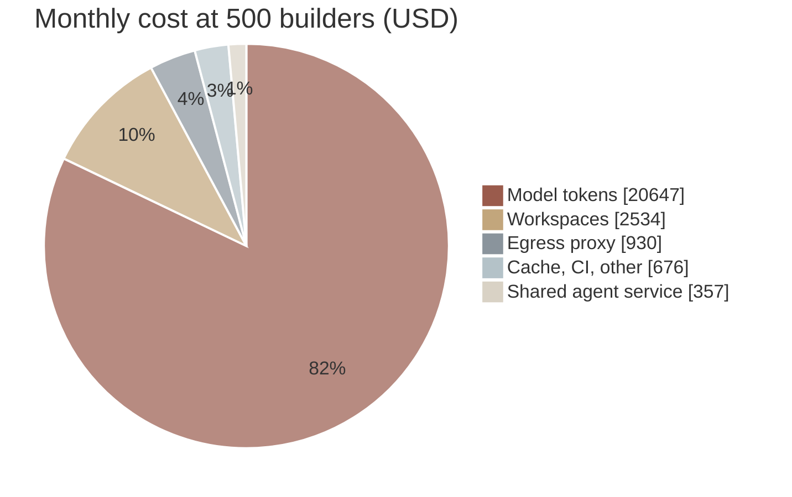

| Per month | Pilot · 50 builders | Scale · 500 builders |
|---|---|---|
| Model tokens (agents + Publish review) | $2,065 | $20,647 |
| Workspaces (one per session) | $253 | $2,534 |
| Shared agent service | $231 | $357 |
| Egress proxy (Secure Web Proxy) | $914 | $930 |
| Cache, CI, other | $113 | $676 |
| **Total** | **≈ $3,600** | **≈ $25,100** |
| Per builder | $72 | $50 |

Assumptions: 8 sessions per builder per month, 1.5 hours active plus 30 minutes idle each, a 4 vCPU / 8 GiB workspace in Paris (europe-west9), about 2.75 agent-hours of Sonnet 5.5 per session, Haiku 5.5 for routing and the fast path. Reusing a corporate egress proxy saves about $900 a month.

## 14. Decisions and open points

| Decided | Choice |
|---|---|
| Services | Generally available GCP services only |
| Agents | One shared agent service on Cloud Run, state in Memorystore for Valkey and Firestore |
| Workspace | One Cloud Run service per session, started at intake. GKE Autopilot with GKE Sandbox later, behind the same workspace API |
| Tier 1 | Stops at Lab |
| Compliance | DPO, legal and AI Act checks at intake |
| Models | Sonnet 5.5 for agents, Haiku 5.5 for routing and the fast path, Opus 5.5 on request |
| Skills | mattpocock/skills forked (MIT), pinned, protected, triggered by platform steps |
| Additions | Gallery rules, synthetic data per domain, AI Act screening, intake examples as tests and evals, day-two cleanup, per-session limits |

**Still open**

- **Harness:** a 2-week test of ADK against one off-the-shelf coding harness on 3 benchmark tasks, recorded as an ADR.
- **Tracker and ticket flow (proposed):** GitHub Issues, the builder approves the plan, human tickets go to the platform team.
- **Tuning after the pilot:** fast-path limits and workspace size.
- **Egress:** reuse a corporate proxy if one exists.
- **Move to GKE Sandbox** when sessions near the Cloud Run quota (1,000 services per project and region), need faster starts, or security asks for gVisor.
