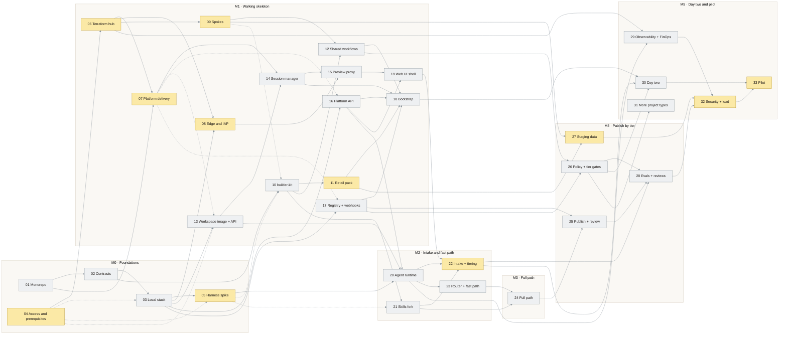

# Builder Studio · build plan

How to build the platform described in [`docs/architecture.md`](../architecture.md), in 33 steps you can hand to a code assistant one at a time.

## What's in this package

| Path | What it is |
|---|---|
| `AGENTS.md` (repo root) | Standing instructions for any code assistant: hard rules, stack, layout, skills, how to work a step, definition of done |
| `CLAUDE.md` (repo root) | Points Claude Code to `AGENTS.md` |
| `.claude/skills/` | The skills from mattpocock/skills, pinned and ready to use |
| `docs/agents/` | The tracker settings those skills expect, already filled in |
| `docs/architecture.md` | The target architecture (diagrams, components, decisions) |
| `docs/plan/steps/` | One brief per step: why, what to build, out of scope, acceptance criteria |
| `docs/plan/scripts/create-issues.sh` | Optional: creates the labels, the milestones and one GitHub Issue per step |

## How to use it

1. Create the `builder-studio` repo and unzip this package at its root, for example `unzip builder-studio-plan.zip -d builder-studio`. There's nothing else to set up: the skills and the tracker settings ship with it.
2. Start **step 04** with the right people on day one. It needs other teams, and it unblocks the cloud work.
3. Give your assistant one step at a time, on its own branch:

   ```text
   Read AGENTS.md, then docs/plan/steps/13-workspace-image-api.md and the
   architecture sections it links. Write a short plan first. Then implement
   the step test-first, staying in scope. Stop when every acceptance
   criterion is met, and show how each one is met in the pull request.
   ```

4. For a size L step, the assistant first splits it into tickets with `to-tickets`, then builds them in parallel with `implement-spec`.
5. Steps marked "Person" or "Assistant + person" need someone for access, an apply, a sign-off or a decision. The step says which.
6. Optional: `docs/plan/scripts/create-issues.sh OWNER/builder-studio` creates the labels, the milestones and one GitHub Issue per step, linked by "blocked by". Run it with `--dry-run` first.

## Defaults this plan uses

Each one is recorded as an ADR in an early step, so you can change it before coding starts:

- **Two repos:** `builder-studio` for the platform itself, and `builder-kit` for everything app repos use.
- **Python 3.14** with uv and FastAPI for the services, and **Pydantic v2** for every data shape: contracts, settings, API bodies, events and model outputs. **React + TypeScript** (Vite) for the Builder Studio UI.
- **Task** (`Taskfile.yml`) for every command, in both platform repos and in every app repo.
- **FastAPI with Jinja2 and HTMX** for the apps builders generate. **Copier** pushes the best practices into every repo, and a weekly update pull request keeps them current.
- **Terraform** and **GitHub Actions**. Generally available GCP services only.
- **The agent harness** is decided by the spike in step 05, not up front.

## Repositories

You maintain two repos. The platform generates the builders' app repos.

| Repo | Access | What it holds | Created in step |
|---|---|---|---|
| `builder-studio` | The platform team only | The platform itself: hub services, workspace, Builder Studio UI, contracts, the hub and spoke Terraform, the delivery pipeline, docs and plan | 01 |
| `builder-kit` | The platform team writes, domain champions own their pack folder, and every app repo and workspace reads it | Everything app repos use: the Copier layers (`agents`, `base`, project types, domain packs), the skills, the shared workflows and the approved app Terraform modules, all under one version tag | 10 |
| App repos | The platform's GitHub App | One per builder app, generated from the kit's layers when the builder confirms the intake | 18 |

- Nobody maintains the golden app by hand: a nightly job in `builder-kit` regenerates it in the sandbox organisation.
- Keep `builder-kit` in the same GitHub organisation as the app repos, so the apps can read it without extra access setup.
- When a step works in `builder-kit` (mostly 10, 11, 12 and 21), open it next to `builder-studio`, so the assistant reads the plan in one and writes in the other.

## Milestones

| Milestone | What you can demo | Steps | Indicative duration |
|---|---|---|---|
| M0 · Foundations | Repo, contracts, local stack, harness decision | 01–05 | 2 weeks |
| M1 · Walking skeleton | Sign in, New app, branded preview, hello world live in Lab | 06–19 | 4 weeks |
| M2 · Intake and fast path | The intake sets the tier; small changes show in seconds | 20–23 | 3 weeks |
| M3 · Full path | Spec, tickets, 3 parallel workers, merge queue | 24 | 3 weeks |
| M4 · Publish by tier | Checks, code review, Staging, approvals, Production | 25–28 | 3 weeks |
| M5 · Day two and pilot | Updates, expiry, gallery, dashboards, hardening, Retail pilot | 29–33 | 3–4 weeks |

Milestones group steps by what you can demo; they overlap. Start any step as soon as its blockers are merged. For example, 26 and 27 can start right after M1. The durations assume 3 to 4 engineers working with code assistants, running the tracks below in parallel. Expect about 4 to 5 months to the pilot.

## Parallel tracks

- **Cloud:** 04 → 06 → 07, 08 and 09 → 12 → 26
- **Kit:** 10 → 11 → 18, then 27 and 31
- **Workspace:** 13 → 14 → 15 → 19
- **Hub services:** 16 and 17 → 18
- **Agents:** 05 → 20 → 23 → 24 → 25, with 21 once the kit exists and 22 once 20 and 21 are done

## Do these early, they carry the most risk

- **04:** the Trust Layer contract, the GitHub App permissions and the Okta setup take the longest to obtain.
- **05:** the harness choice shapes the whole agent service.
- **09:** ADR 0006 (how apps are exposed and protected in the spokes) shapes the template's auth code and every app's infrastructure.
- **13 and 14:** measure the workspace's cold start and the Cloud Run quotas early. They decide whether the intake hides the start-up time.
- **27:** the data owners' sign-off on masking takes time. Ask early.

## Dependency graph

A rendered copy is in [`dependency-graph.png`](dependency-graph.png). Yellow steps need a person. Solid arrows block; dotted arrows are needed later in the step (for example to deploy). The graph omits arrows already implied by another path; the table lists them all.



## All steps

| # | Step | Milestone | Who | Size | Blocked by | Needs later |
|---|---|---|---|---|---|---|
| 01 | [Platform monorepo and conventions](steps/01-platform-monorepo.md) | M0 | Assistant | S | none | – |
| 02 | [Contracts and schemas](steps/02-contracts-and-schemas.md) | M0 | Assistant | M | 01 | – |
| 03 | [Local development stack](steps/03-local-dev-stack.md) | M0 | Assistant | M | 01, 02 | 04 |
| 04 | [Access and prerequisites](steps/04-access-and-prerequisites.md) | M0 | Person | M | none (start on day one) | – |
| 05 | [Harness spike and ADR](steps/05-harness-spike.md) | M0 | Assistant + person | M | 02, 03 | 04 |
| 06 | [Terraform: hub foundations](steps/06-terraform-hub.md) | M1 | Assistant + person | L | 04 | – |
| 07 | [Platform delivery pipeline](steps/07-platform-delivery.md) | M1 | Assistant + person | M | 01, 06 | – |
| 08 | [Terraform: edge and identity](steps/08-terraform-edge-identity.md) | M1 | Assistant + person | M | 03, 06 | – |
| 09 | [Terraform: spoke module and the Retail spoke](steps/09-terraform-spokes.md) | M1 | Assistant + person | L | 06 | – |
| 10 | [Template kit: builder-kit, layers and golden app](steps/10-builder-kit.md) | M1 | Assistant | L | 02 | 05, 09 |
| 11 | [Template: Retail domain pack](steps/11-retail-domain-pack.md) | M1 | Assistant + person | M | 10 | – |
| 12 | [Shared GitHub workflows](steps/12-shared-workflows.md) | M1 | Assistant | M | 09, 10 | – |
| 13 | [Workspace image and workspace API](steps/13-workspace-image-api.md) | M1 | Assistant | L | 02, 03 | 04, 07 |
| 14 | [Session manager](steps/14-session-manager.md) | M1 | Assistant | M | 07, 13 | – |
| 15 | [Preview proxy](steps/15-preview-proxy.md) | M1 | Assistant | M | 07, 08, 14 | – |
| 16 | [Platform API](steps/16-platform-api.md) | M1 | Assistant | L | 02, 03 | 07 |
| 17 | [Registry API and webhook receiver](steps/17-registry-webhooks.md) | M1 | Assistant | M | 02, 03 | 07 |
| 18 | [Bootstrap: repo, registry draft and hello world in Lab](steps/18-bootstrap.md) | M1 | Assistant | M | 07, 11, 12, 14, 16, 17 | – |
| 19 | [Web UI shell](steps/19-web-ui-shell.md) | M1 | Assistant | M | 15, 16 | – |
| 20 | [Agent runtime](steps/20-agent-runtime.md) | M2 | Assistant | L | 05, 13, 16 | – |
| 21 | [Skills fork](steps/21-skills-fork.md) | M2 | Assistant | M | 10 | 05 |
| 22 | [Intake agent and tiering](steps/22-intake-tiering.md) | M2 | Assistant + person | M | 19, 20, 21 | – |
| 23 | [Router and fast path](steps/23-router-fast-path.md) | M2 | Assistant | M | 20 | – |
| 24 | [Full path: spec, tickets, parallel workers and merge queue](steps/24-full-path.md) | M3 | Assistant | L | 21, 23 | – |
| 25 | [Publish, review runner and status](steps/25-publish-review.md) | M4 | Assistant | M | 17, 21, 24 | – |
| 26 | [Policy, tier gates, Staging and Production](steps/26-policy-tier-gates.md) | M4 | Assistant | L | 09, 12, 17 | – |
| 27 | [Staging data and connectors](steps/27-staging-data-connectors.md) | M4 | Assistant + person | L | 09, 11 | – |
| 28 | [Eval runner and tracked reviews](steps/28-evals-reviews.md) | M4 | Assistant | M | 22, 25, 26 | – |
| 29 | [Observability and FinOps](steps/29-observability-finops.md) | M5 | Assistant | M | 06, 20 | – |
| 30 | [Day two: updates, expiry, reopen and gallery](steps/30-day-two.md) | M5 | Assistant | M | 18, 22, 26 | – |
| 31 | [More project types](steps/31-more-project-types.md) | M5 | Assistant | M per type | 10, 26 | – |
| 32 | [Security hardening and load test](steps/32-security-load.md) | M5 | Assistant + person | L | 27, 28, 29 | – |
| 33 | [Pilot with the Retail domain](steps/33-pilot.md) | M5 | Person | M | 30, 32 | – |
